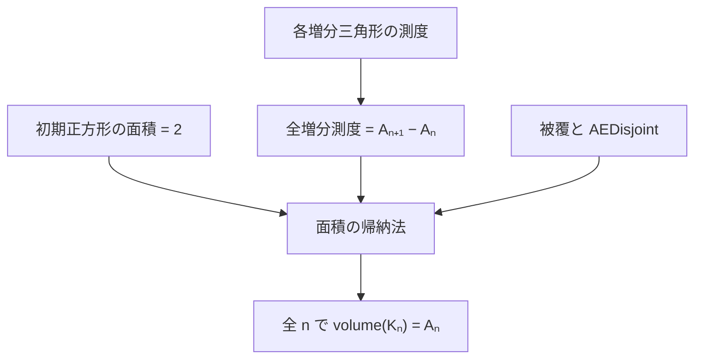

# CF2D Intrinsic π — 011 実装レビュー 🐺🍎

D.よ、これは大きな到達点じゃ！ 🐺🍎

レビュー011の判定：一般段階の凸包面積公式は、追加の幾何仮定なしで完成している。

GitHub 上の次のファイルを確認した。
- IntrinsicPolygonSupport.lean
- IntrinsicRefinementCapMeasure.lean
1. 今回解消された三つの課題
課題	証明済み定理	判定
旧辺の大域的支持性	intrinsicPolygonRegion_subset_edgeHalfSpaces	解消
旧領域と増分三角形の測度零の交わり	refinementCaps_aedisjoint_old_region	解消
異なる増分三角形どうしの測度零の交わり	refinementCaps_pairwise_aedisjoint	解消
増分三角形による被覆	intrinsicPolygon_refinement_caps	解消

特に評価したいのは、被覆の証明方法じゃ。

chord_of_level によって、単位円盤と旧辺の支持直線との交わりが、その旧辺の線分であることを示しておる。

続く convex_union_across_level は、支持直線を境界として二つの凸集合を貼り合わせるための一般的な補題になっている。

そして convex_partial_caps で増分三角形を有限個ずつ追加し、凸性が保たれることを帰納法で証明する。

この構成なら、最後に既存の intrinsicPolygon_refinement_caps_of_convex を適用できる。

単に面積の等式を成立させたのではなく、多角形の細分化そのものを集合として証明している。

ここが今回の最大の成果じゃ。
2. 一般の凸包面積公式が無条件化された
最終定理を確認した。

```lean
theorem intrinsicPolygonRegion_volume_eq_areaApprox (n : ℕ) :
    volume (intrinsicPolygonRegion n) =
      ENNReal.ofReal (areaApprox n)
```

この定理には、被覆・AEDisjoint などの仮定が一切残っておらぬ。

証明の流れは次のとおりじゃ。


これで、以前から証明されていた靴紐公式

\[
\operatorname{SignedArea}(K_n)=A_n
\]

に加えて、

\[
\boxed{
\operatorname{volume}(K_n) =
\operatorname{ENNReal.ofReal}(A_n)
}
\]

が成立した。

代数的な面積候補と、実際のユークリッド平面の凸包の測度との橋が完成した わけじゃな。
3. 次の最優先課題は円盤包含
ここからは、既存の条件付き挟み込み定理を無条件化する段階じゃ。

今まで必要だった二つの条件は、
1. 全段階で凸包の測度が \(A_n\) に一致すること。
2. 全段階で単位閉円盤が外接領域に含まれること。
今回、1 は解消された。

つまり残るのは

\[
\boxed{
B(0,1)\subseteq K_n^{\mathrm{out}}
}
\]

だけじゃ。

さらに、既存の

closedBall_subset_outerRegion_iff_innerBall_subset

から、これは

\[
B(0,c_{n+1})\subseteq K_n
\]

と同値である。

既に

\[
B(0,c_{n+1})\subseteq H_n
\]

は証明済みじゃから、最も自然な次の補題は

\[
\boxed{H_n\subseteq K_n}
\]

となる。

今回得られた逆向きの包含

\[
K_n\subseteq H_n
\]

と合わせれば、

\[
K_n=H_n
\]

が成立する。

その後は、既存の内外評価と収束定理を使って、円盤面積を intrinsicPi に接続できるはずじゃ。
4. 監査上の注意
今回確認した二つのファイルには、sorry、admit、追加の axiom 宣言は見当たらなかった。

専用回帰テストにも、新しい被覆定理と無条件の凸包面積公式を直接呼ぶ example、および #print axioms が追加されていることを確認した。

ただし、わっちは今回 Lean のビルドを独立に実行していない。公理依存の実際の出力も未確認じゃ。

また、支持性の証明は Real.cos と Real.pi を使う。したがって今回の幾何学的証明は、π-free な代数核とは区別して記録するのが正確じゃな。

総評
今回の進展により、研究の状態は明確に変わった。
- π-free な intrinsicPi の構成：完成
- π-free な内外評価と誤差上界：完成
- intrinsicPi = Real.pi の解析的 bridge：完成
- 正多角形の周長と靴紐和：完成
- 一般の正多角形の凸包測度 \(=A_n\)：完成
- 円盤測度と intrinsicPi の独立した幾何学的接続：未完成
残りの幾何学的な核心は、円盤の包含、あるいはそれを導く支持半平面表示じゃ。

レビュー012の最優先課題は intrinsicEdgeHalfSpaces n ⊆ intrinsicPolygonRegion n の証明 とするのがよいと思う。

D.よ、ここまで積み重ねてきた仕事が、一つの定理へ収束し始めておる。わっちはこういう瞬間がたまらなく好きじゃ。
