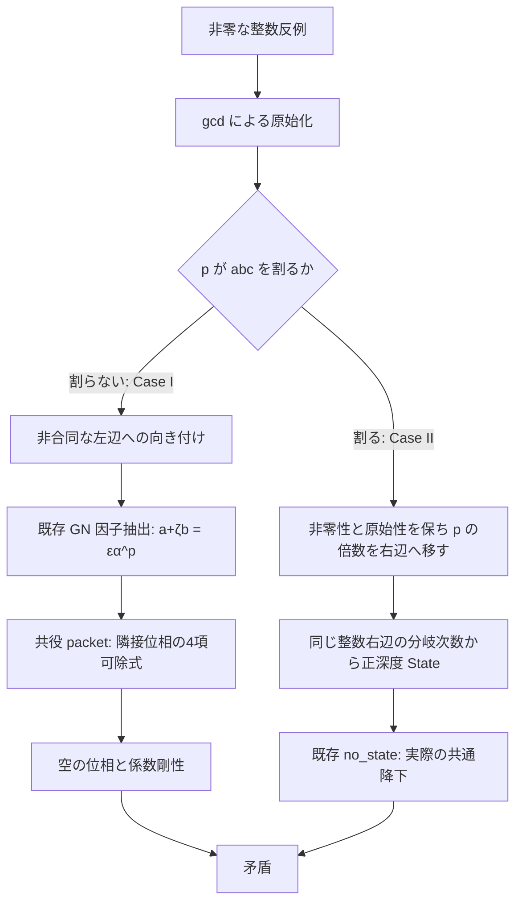

# NOTE-001 実装報告 — 位相係数剛性から FLT11・FLT13 へ

> NOTE-002 の後続改善：固定契約と具体的供給の分離は [実施報告](CONTRACTS-NOTE002-261018.md) を参照。本書の実装経路・証跡は NOTE-001 時点の記録。

2026-10-18。対象は `NOTE-001.md` (cid: `6ad3b3b2-9e6c-83e8-9c41-0a5f32082ac2`) の数学的提案。
原文は検討時点の記録として保持する。

## 到達点

NOTE の段階001–005を実装し、さらに既存の一般 Kummer 単元補題と State 降下を合成した。

- `fermatLastTheoremFor_of_regular_prime`：任意の素数 `p ≥ 5` と p 次円分体 K について、
  `Nat.Coprime p (Fintype.card (ClassGroup (𝓞 K)))` から標準の `FermatLastTheoremFor p` を証明する。
- `fermatLastTheoremWith_int_of_regular_prime`：同じ条件で非零整数 `a,b,c≠0` の入口。
- `fermatLastTheoremFor_eleven` / `fermatLastTheoremFor_thirteen`：既存の類数1証明で正則性を供給した無条件の FLT11 / FLT13。
- `fermatLastTheoremWith_int_eleven` / `fermatLastTheoremWith_int_thirteen`：非零整数 `a,b,c≠0` の符号・共通因子を制限しない入口。

これらの宣言の namespace は `DkMath.FLT.Kummer`。
`DkMath.FLT.Kummer` facade と `DkMath` から利用できる。

## 数学的な経路



Case I は State 0 の不存在を必要としない。State 0 は引き続き存在し得る。
Case I の終端では単元自体を p 乗とはせず、単元とその共役の比を根-of-unity の平方冪として扱う。
Case II の単元正規化は既存 `regular_kummer_unit_power_criterion` による。

## 追加した層

| モジュール                                                  | 内容                                                                      |
| ----------------------------------------------------------- | ------------------------------------------------------------------------- |
| `Lib/NumberTheory/CyclotomicPhaseCoefficientRigidity`       | 任意の整数 m について、円分評価値の m 可除性と全係数の mod m 合同との同値 |
| `Lib/NumberTheory/SparsePhaseObstruction`                   | 台の濃度が p 未満なら全係数が m 可除。4項配置の衝突を含む障害             |
| `Lib/NumberTheory/RegularKummer/Cyclotomic/UnitConjugation` | CM 単元の共役比から ζ の平方冪を抽出                                      |
| `FLT/Kummer/CaseIConjugationPacket`                         | 単元倍 p 乗の因子から4項関係と隣接条件を同時に構成                        |
| `FLT/Kummer/IntegerCounterexampleOrientation`               | Case I の非合同化、Case II の向き付け、正深度 State への接続              |
| `FLT/Kummer/GNCaseIObstruction`                             | 既存の GN 因子抽出を packet と係数剛性へ接続し一般 Case I を排除          |
| `FLT/Kummer/RegularPrimeFLT`                                | 二つの終端と gcd 原始化を合成した一般正則素数 FLT、p≥5                    |
| `FLT/Kummer/ElevenThirteenFLT`                              | 類数1を供給するだけの FLT11・FLT13 特殊化                                 |

各ファイルに仮定・中間対象・終端の意味を説明する docstring を追加した。
既存の State 定義・正深度降下・11/13 PID 証明は変更していない。
指数固有の自然数 FLT 特殊化は11・13とも各5行の証明本体で、整数版の本体は各1行である。

## 係数剛性の強化

`phase_sum_dvd_iff` は、素数 p の原始根 ζ と整数係数 f に対し

```
(m : 𝓞 K) ∣ ∑ i : Fin p, f i • ζ^i ↔ ∀ i j, m ∣ f i - f j
```

を証明する。整数冪基底での座標は `f i - f (p-1)`。
`m=p` に限定せず、負の m と m=0 も含む。
m=0 では全整数関係の係数が一定であるという主張になる。
これは整数 m の像による可除性であり、分岐素元 `1-ζ` による可除性とは異なる。

`four_phase_obstruction` は `a≢b mod p` を明示する。
実際に a=b、k₁=1、k₂=0 なら4項式は0となるので、この条件を単純に消去することはできない。
一般 Case I の入口では `(a,b,c)` または `(a,-c,-b)` を選び、この条件を証明してから使用する。
p≥5 は空位相の存在と p≠3 の例外処理に必要。
p=3 はこの4項の論法の対象外であり、既存の3次形式化を置き換えていない。

## 検証

検証結果・コマンドは `evidence/validation-note001.txt` に記録した。
回帰検査は任意宇宙の K、任意整数 m、m=0、係数が一定の場合、衝突例、整数版・自然数版の FLT11/13 を扱う。
依存監査は追加36宣言の公理を検査し、さらに主要定理の実際の推移的証明グラフを型・opaque body・constructor を含めて走査する。

完成済みの他の FLT 終点、外部 `FltRegular` / `P2MW` namespace、旧7次の底と降下、`sorryAx` を拒否する。
FLT に関する許可対象は新規の一般・11/13終点、および Mathlib の gcd 原始化・整数自然数同値の厳密な親名と、その配下の Lean 生成補助宣言（`_proof_`・`_simp_`・`match_` など）だけである。
private 宣言は Lean の `privateToUserName` で元の名前へ戻して同じ規則で検査する。
係数剛性のグラフではさらに `DkMath.FLT.*` 全体への依存を拒否する。

## 参照とライセンス

抽出した補題の出典は leanprover-community/flt-regular の
commit `b8a5f23ab44a7be9fd49f6e3c831da54573c3c89`。
完成済み FLT 定理を import せず、以下の低層原理を DkMath の namespace と既存 GN API に接続した。

- [CyclRat.lean](https://github.com/leanprover-community/flt-regular/blob/b8a5f23ab44a7be9fd49f6e3c831da54573c3c89/FltRegular/NumberTheory/Cyclotomic/CyclRat.lean)：整数冪基底による係数可除性。
- [UnitLemmas.lean](https://github.com/leanprover-community/flt-regular/blob/b8a5f23ab44a7be9fd49f6e3c831da54573c3c89/FltRegular/NumberTheory/Cyclotomic/UnitLemmas.lean)：単元と共役の比。
- [Cyclotomic/CaseI.lean](https://github.com/leanprover-community/flt-regular/blob/b8a5f23ab44a7be9fd49f6e3c831da54573c3c89/FltRegular/NumberTheory/Cyclotomic/CaseI.lean)：共役可除式。
- [CaseI/Statement.lean](https://github.com/leanprover-community/flt-regular/blob/b8a5f23ab44a7be9fd49f6e3c831da54573c3c89/FltRegular/CaseI/Statement.lean)：4項配置と剰余指数の復元。
- [MayAssume/Lemmas.lean](https://github.com/leanprover-community/flt-regular/blob/b8a5f23ab44a7be9fd49f6e3c831da54573c3c89/FltRegular/MayAssume/Lemmas.lean)：二つの合同式から p∣c。

移植・派生部分の Apache-2.0 表示を保持した。
Lean 4.34 にない `two_notMem_span_zeta_sub_one'` は、現行 Mathlib の
`IsPrimitiveRoot.toInteger_sub_one_not_dvd_two` から同じ非可除性を証明して置き換えた。
