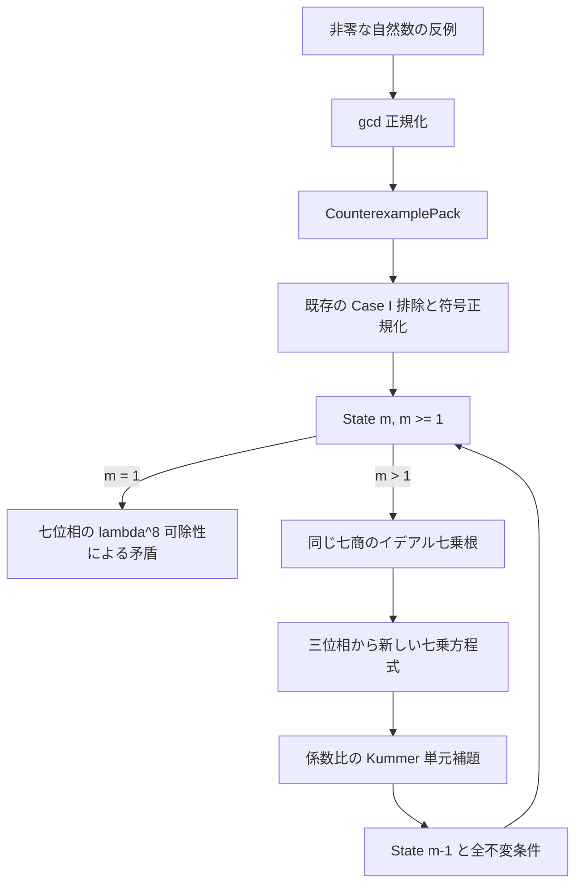

# FLT7 を閉じる Lean 教科書：GN の七位相と分岐深度降下

2026/10/17 JST

## 到達した定理

```lean
DkMath.FLT.Kummer.SevenDescent.fermatLastTheoremFor_seven :
  FermatLastTheoremFor 7
```

追加の降下provider、原始性、正則性、単元補題を引数に取らない。
Mathlibそのものの `FermatLastTheoremFor 7` として検査する回帰例を置いた。
正の自然数については `seventh_sum_ne_seventh ha hb hc` が直接の入口となる。

入口: `DkMath.FLT.Kummer`。証明本体は [SevenGNDescent.lean](../../../DkMath/FLT/Kummer/SevenGNDescent.lean)。
前章 [Proof Route Audit](FLT7-PROOF-ROUTE-AUDIT.md) で明示的な仮定だった底とstepを、今回は両方実装した。
以前の共通補正根・ノルムパケットは研究成果として保存する。

## 1. 何を反復するか

自然数の反例を毎回作り直す必要はない。円分整数環の具体的六次モデル
`C = SevenCyclotomicDegreeSixInt.Ring` で次の状態を反復する。

\[
\boxed{x^7+y^7=\varepsilon(\lambda^m z)^7},
\qquad \lambda=1-\zeta,
\qquad \lambda\nmid y,z,
\qquad \operatorname{IsCoprime}(x,y).
\]

実装の型は `SevenDescent.State m`。
前章のscratchと異なり、大域的な互いに素性を **明示的な不変条件** に加えた。
元の反例でこれを供給し、遷移後の同じ新しい二根についても証明する。
したがって、お手本の共通gcdを無断で捨てたわけではない。
この強い不変条件のおかげで、分数イデアルの比を経由せず七次PIDで各商を主イデアル化できる。

`State 0` は `(x,y,z,ε)=(0,1,1,1)` という証人を持つ。
**不存在を証明する範囲は m≥1 に限る。**



## 2. 宇宙式を壊さず GN / GTail に移す

gapを `x+y`、parameterを `-y` とすれば

\[
x^7+y^7=(x+y)\,GN_7(x+y,-y)
       =(x+y)\,GTail_{7,1}(x+y,-y).
\]

[SevenDescentState.lean](../../../DkMath/FLT/Kummer/SevenDescentState.lean) の
`seventh_sum_eq_gn`、`seventh_sum_eq_gtail`、`State.gn_equation` がこの翻訳を行う。
恒等式自体を否定するのではなく、右辺の七乗形と分岐条件が両立しないことを示す。

同じStateの全七位相を

\[
A_i=x+\zeta^i y\quad(0\le i<7)
\]

と書く。実装は既存のGN位相API
`focused_pow_sub_pow_eq_prod_fin` を使い

\[
x^7+y^7=\prod_{i=0}^6 A_i
\]

を得る。位相0、すなわち端点和 `x+y` も捨てない。

## 3. 全七商と特別な一位相

正深度のStateを分岐評価 `ramifiedEval : C →+* ZMod 7` に送ると
`x+y≡0 mod λ`。実際の商qを選び

\[
x+y=\lambda q
\]

とする。位相差の係数を

\[
T_i\lambda=\zeta^i-1,\qquad T_0=0
\]

で定めると、全因子は同じqを用いて

\[
A_i=\lambda q_i,\qquad q_i=q+T_i y
\]

となる。`State.center` と `State.quotient` はこの同じ証人を保持する。

分岐剰余では `T_i≡-i`。従って

\[
\overline{q_i}=\overline q-i\overline y.
\]

`λ∤y` より y の剰余は非零なので、これが零になる位相はただ一つ。
`State.distinguishedPhase` は `val(q̄/ȳ)` として具体的に選び、
`State.quotient_dvd_iff` は

\[
\lambda\mid q_i\iff i=i_0
\]

を証明する。
この部分は [SevenDescentPhases.lean](../../../DkMath/FLT/Kummer/SevenDescentPhases.lean)。

## 4. なぜ深度1は不可能か

七因子を剥離した積は

\[
x^7+y^7=\lambda^7\prod_i q_i.
\]

特別なqᵢ₀はもう一つlambdaを含むから、左辺はlambda^8で割れる。
一方、State 1 の右辺は `ε(λz)^7` である。
lambda^7を消去すると `λ∣εz^7`。
単元εと非分岐なzにより矛盾する。

`no_state_one : ¬ Nonempty (State 1)` はこの証明で閉じる。
七次PIDやKummer単元補題は、底の排除には使っていない。

## 5. 七商の七乗根を取り出す

原始性から `IsCoprime q_i y` が従う。
さらに異なる位相では `T_i-T_j` が大域的な円分単元であり、

\[
q_i-q_j=(T_i-T_j)y
\]

となる。これにBezoutの等式を代入すれば、異なるqᵢ,qⱼは互いに素となる。

State (m+1) の積から七つのlambdaを消去すると

\[
\prod_i q_i=\varepsilon(\lambda^m z)^7.
\]

主イデアルへ移すと単元が消え、互いに素なイデアルへ七乗を配分できる。
既存の `Finset.exists_eq_pow_of_mul_eq_pow_of_coprime` と
`PrincipalIdealPower` のAPIを使い、七次PIDで

\[
q_i=u_i b_i^7,\qquad u_i\in C^\times
\]

を同時に構成する。
この段階では単元uᵢを捨てない。
実装は [SevenDescentPowers.lean](../../../DkMath/FLT/Kummer/SevenDescentPowers.lean)。

特別な位相以外の商はlambdaで割れないので、その根bᵢも非分岐である。
積の全分岐冪は特別な位相へ集まり、同じ族のbᵢ₀から

\[
b_{i_0}=\lambda^m g,\qquad \lambda\nmid g
\]

を得る。`State.exists_descent_roots` は同じ七単元・七根・gと、それらの等式と
非分岐性・互いに素性を一つの存在証明に保持する。

## 6. 三位相から次の方程式を構成する

特別な位相i₀と、それ以外の異なる二位相i₁,i₂を選ぶ。
同じqを持つ商の一次式から

\[
(T_{i_2}-T_{i_0})q_{i_1}+(T_{i_0}-T_{i_1})q_{i_2}
 =(T_{i_2}-T_{i_1})q_{i_0}
\]

が厳密に成立する。七乗表示を代入すると

\[
U X^7+V Y^7=E(\lambda^m Z)^7
\]

を得る。ここで `X=bᵢ₁`、`Y=bᵢ₂`、`Z=g` であり、全係数U,V,Eは単元。
同じX,Y,Zについて

\[
\operatorname{IsCoprime}(X,Y),\qquad \lambda\nmid X,Y,Z
\]

も証明する。
これは以前のノルム比較から推測した式ではなく、実際の元の等式の再構成である。

## 7. 新しい係数比を七乗へ正規化する

m≥1なら右辺は7で割れる。
Xは非分岐だから `IsCoprime 7 X`。
Bezoutの係数bを選べば `bX≡1 mod7` なので、式全体から

\[
U/V\equiv(-bY)^7\pmod7
\]

となる。

任意のa∈Cについて `a⁷` はmod7で整数に合同である。
実装の `seventh_congr_integer` は、aの分岐剰余を整数nで持ち上げ、
`a=n+λw` と二項係数の7可除性、`7∣λ⁶` を使って証明する。
したがってU/Vは整数にmod7で合同であり、既存の
`concrete_kummer_unit_power_criterion` が

\[
U/V=\kappa^7
\]

という実際の単元根を返す。
[SevenDescentUnits.lean](../../../DkMath/FLT/Kummer/SevenDescentUnits.lean) の
`ratio_seventh` がこの適用条件まで供給する。

XをκXへ置き換えれば

\[
(\kappa X)^7+Y^7=(E/V)(\lambda^m Z)^7.
\]

同じY,Zの非分岐性と、単元倍で保存される原始性により、これが `State m` となる。

[SevenDescentStep.lean](../../../DkMath/FLT/Kummer/SevenDescentStep.lean) の結論は

```lean
descent_step (m : ℕ) :
  Nonempty (State (m + 1)) → Nonempty (State m)
```

であり、providerを仮定するだけのインターフェースではない。
上の七根・三位相・単元比から新状態を実際に構成している。

## 8. 自然数のFLT7へ戻る

`no_state` は深度1の排除と実装済みstepを `Nat.le_induction` で反復し、
すべての正深度のStateを排除する。

元の `CounterexamplePack` からの入口は既存のCase I排除と三端点の符号正規化を使う。
`PrimitiveRamifiedSummitPacket` の `distinguished` をlambdaで完全に剥離し、
非分岐なzと正深度mを得る。元の自然数反例をこの状態へ入れるのはこの一度だけでよい。
`initial_state_of_counterexample` は追加のcommon-primeや実三次orbitを要求しない。

最後にMathlibの
`fermatLastTheoremWith_of_fermatLastTheoremWith_coprime`
で自然数の三端点のgcdを除く。
その同じ七乗方程式から二端点の `Nat.Coprime` を回復し、`CounterexamplePack` を構成する。
これで任意の非零自然数三つについて `a⁷+b⁷≠c⁷` となる。

## 9. 何を再利用し、何に依存しないか

再利用する実体は、既存DkMathのprimitive Case I排除・ramified summit、
七次PID、Cと円分整数環の対応、具体的Kummer単元補題、LibのGN位相分解とイデアル冪抽出である。
新しい教科書の内部降下は七次の具体的環Cに限定した。
一般の正則素数に対するFLTの再証明まで完了したとは主張しない。

以前のcurrent六因子族・補正根Gamma・小ノルムパケット・選択common-primeは最終証明の依存に入らない。
七乗ノルムの保存から降下を主張するのではなく、七乗**方程式と不変条件**を降下させた。

比較の数学的な出発点は、ユーザー提供AnthropicコピーのCase IIと
[flt-regular CaseII/InductionStep](https://github.com/leanprover-community/flt-regular/blob/master/FltRegular/CaseII/InductionStep.lean)。
本実装では大域的な原始性の保存を追加して、共通gcdと分数イデアル比を迂回した。
外部FLT7の証明をimportしたり、正則素数FLTを仮定したりしていない。

## 検証

公開39定理・4定義・1構造体、合計44宣言の公理whitelistを検査する。
回帰例では、Mathlib標準FLT7型、原始性を仮定しない非零自然数三つ、
正深度の不存在、深度0の実際の証人を確認する。
再帰的依存監査は型・opaque本文・コンストラクタを読み、実際の底・step・GN因子分解・
七次PID・具体的単元補題・gcd正規化への依存を要求する。
禁止する外部終点・旧補正パケット・sorryAxが出現しないことも検査する。

実行範囲と結果は [検証記録](evidence/validation-seven-gn-descent.txt) を参照。
